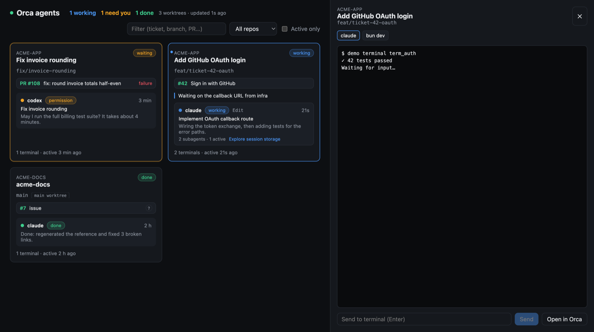

# orca-dashboard

[](https://github.com/ethansmadjaa/orca-dashboard/actions/workflows/ci.yml)
[](LICENSE)

A live web dashboard for the coding agents you run in [Orca](https://github.com/stablyai/orca). It shows every worktree in one place: branch, linked GitHub issue and PR, the state of each agent and subagent, and the live terminal output. You can also reply to an agent without switching windows.



## Features

- **Everything at a glance.** Each worktree shows its repo, branch, status, Orca comment, issues and PR (with CI checks), and every agent with its current tool, last message and active subagents.
- **Triage first.** Worktrees where an agent is waiting on you (a permission prompt or a question) are sorted to the top and highlighted. Busy ones come next.
- **Live terminals.** Click an agent to tail its terminal, send it text (followed by Enter), or jump to it in Orca.
- **Issue and PR detection.** The dashboard uses Orca's links first. Failing that, it looks for `ticket-12` in the branch name, then `ticket #12` or `PR #34` in the agent's prompt (marked with `?`). Titles and states come from `gh` and are cached for 5 minutes.
- **Filter** by text (ticket, branch, PR, agent task), by repo, or show active worktrees only.
- **Local only.** The server binds to `127.0.0.1`, rejects foreign `Host` headers (DNS rebinding), and only accepts writes from its own page (CSRF).

## Requirements

- [Bun](https://bun.sh) ≥ 1.2.3
- [Orca](https://github.com/stablyai/orca) running locally, with the `orca` CLI on your `PATH`
- Optional: the [GitHub CLI](https://cli.github.com) (`gh`), logged in, for issue and PR titles and states

## Quick start

```sh
git clone https://github.com/ethansmadjaa/orca-dashboard.git
cd orca-dashboard
bun install
bun run dev        # http://127.0.0.1:4317
```

No Orca installed? `bun run demo` starts the dashboard with fake data.

## Configuration

| Variable              | Default | Description                                  |
| --------------------- | ------- | -------------------------------------------- |
| `PORT`                | `4317`  | HTTP port (always on `127.0.0.1`)            |
| `ORCA_CLI_COMMAND`    | `orca`  | Path or name of the Orca CLI                 |
| `ORCA_DASHBOARD_DEMO` | unset   | `1` serves fake data instead of calling Orca |

## How it works

While at least one tab is open, the server polls `orca worktree ps` and `orca terminal list` every 2 seconds and pushes the merged result to the browser over Server-Sent Events. When no tab is open, it stops polling. Terminal tails are fetched on demand. Writes go through `orca terminal send` and `orca terminal switch`, called with an argument array (no shell is involved).

See [docs/ARCHITECTURE.md](docs/ARCHITECTURE.md) for the module map.

## Development

```sh
bun run check          # typecheck + lint + format check + tests
bun run test:watch     # Vitest in watch mode
bun run test:coverage
bun run lint:fix && bun run format
```

Contributions are welcome. Read [CONTRIBUTING.md](CONTRIBUTING.md) first.

## Security

The dashboard can type into your agents' terminals, so it is built to be reachable only from your own machine. Please report vulnerabilities privately: see [SECURITY.md](SECURITY.md).

## License

[MIT](LICENSE). This is not an official Orca project.
